<p align="center">
  
</p>

<p align="center">
  <a href="https://github.com/NupurBhaisare/macropress/actions/workflows/ci.yml"></a>
  <a href="LICENSE"></a>
  <a href="#install"></a>
</p>

MacroPress reads the VBA macros behind a workbook's buttons, converts them to Python, and runs them on a copy of the
`.xlsm`: values, formulas, sheets, sorting and filters. You get the updated workbook and a JSON report of what changed.
It runs anywhere Python runs (a Linux server, a container, CI, an AI agent's sandbox) with no Excel, no Windows and no
Office licence.

When a macro does something MacroPress does not model, it stops that button and says so. It does not guess.

```console
$ macropress buttons invoice.xlsm
$ macropress press invoice.xlsm --button "Calculate totals" --out invoice-done.xlsm
```

## Why

A lot of real work lives in Excel workbooks with VBA behind buttons: "paste this week's data, press Prepare, then
press Run Split". Running those buttons from software has meant driving a real copy of Excel through COM automation
on Windows. That is slow and fragile, hard to run on a server or in a container, licensed per machine, and it gives
every macro full access to the machine it runs on.

MacroPress treats the VBA as source code instead. It converts it to Python and runs it against a model of the parts
of Excel that macros use, built to give the same results as Excel. Where the model has a gap, the run stops with
"not modelled", so you don't get a workbook that is quietly wrong.

It was built so an AI agent could run the workbooks people send it: list the buttons, press the right ones in order,
and hand back the result. It works just as well in a script, a scheduled job or a test suite.

## What it does

- **Finds the buttons**: form-control buttons and shapes with a macro assigned, by the caption they show. Any macro
  can also be pressed by its name.
- **Converts the VBA to readable Python**, one function per procedure, with each VBA line kept as a comment above
  its translation.
- **Runs it against a model of the workbook**: `Range`, `Cells`, `End(xlUp)`, `CurrentRegion`, `Offset`, `Resize`,
  `Copy` and `PasteSpecial`, `Sort`, `AutoFilter`, `ClearContents`, sheets and named ranges, formulas that recalculate
  when their inputs change, `WorksheetFunction`, and VBA's own rules: Variant conversions, banker's rounding, error
  numbers, `On Error`. The full list is in [docs/supported.md](docs/supported.md).
- **Answers the questions macros ask**: answers to `MsgBox` and `InputBox` come from the command line, and `Now`,
  `Date` and `Timer` run on a clock you can fix, so a run can be repeated exactly.
- **Saves a copy and never writes to the original**: only the sheets the macros changed are rewritten. Everything
  else in the file (the VBA project, styles, drawings, the other sheets) is copied byte for byte.
- **Reports in JSON** what each button did, which cells changed, and which of its assumptions about Excel the run
  relied on that have not yet been checked against Excel. What stops a run is in the report, not in a traceback.

## Install

MacroPress needs **Python 3.11**: its VBA parser, [vb2py](https://pypi.org/project/vb2py/), depends on a C extension
(SimpleParse) that does not build on Python 3.12 or later.

```bash
pip install "git+https://github.com/NupurBhaisare/macropress"
```

Or, to install it as a command-line tool kept apart from your other Python packages:

```bash
uv tool install --python 3.11 "git+https://github.com/NupurBhaisare/macropress"
pipx install --python python3.11 "git+https://github.com/NupurBhaisare/macropress"
```

On macOS and Linux, pip compiles SimpleParse from source, which needs a C compiler: the Xcode Command Line Tools
(`xcode-select --install`) or your distribution's build tools (`build-essential` on Debian and Ubuntu). On Windows it
installs a prebuilt wheel.

## Quick start

The [examples](examples/) folder has three small workbooks to try. List the buttons in one:

```console
$ macropress buttons examples/invoice/invoice.xlsm
```

```json
{
  "input": "examples/invoice/invoice.xlsm",
  "buttons": [
    {"caption": "Calculate totals", "macro": "CalculateTotals", "sheet": "Invoice"},
    {"caption": "Apply discount", "macro": "ApplyDiscount", "sheet": "Invoice"},
    {"caption": "Clear totals", "macro": "ClearTotals", "sheet": "Invoice"}
  ],
  "macros": [
    {"module": "Invoice", "name": "CalculateTotals", "kind": "sub", "scope": "Public", "lines": [7, 23], "on_a_button": true},
    ...
  ]
}
```

Press buttons by caption or macro name, in order. `Apply discount` asks two questions, which `--answer` answers in
the order they are asked; `--now` fixes the clock:

```console
$ macropress press examples/invoice/invoice.xlsm \
    --button "Apply discount" --answer 10 --answer yes \
    --button "Calculate totals" \
    --out invoice-done.xlsm --now "2026-04-01 09:30:00"
```

```json
{
  "input": "examples/invoice/invoice.xlsm",
  "steps": [
    {"button": "Apply discount", "status": "completed"},
    {"button": "Calculate totals", "status": "completed"}
  ],
  "output": "invoice-done.xlsm",
  "changes": [
    {
      "sheet": "Invoice", "cells_changed": 16, "rows_with_data_before": 8, "rows_with_data_after": 11,
      "hidden_rows_changed": false,
      "examples": [{"cell": "C5", "before": 4.5, "after": 4.05}, ...]
    }
  ],
  "unverified_behaviours": [
    "- `FORMULAS-RECALCULATED` [unverified] x8: Formulas whose inputs changed are recalculated before their values are read ...",
    ...
  ],
  "messages": ["InputBox: Discount on every unit price, in percent:", "MsgBox: Lower every unit price by 10%?"]
}
```

`invoice-done.xlsm` opens in Excel with the discounted prices and the new totals. The exit code is 0 when every
button completed and 1 otherwise, and the JSON report is always the last line of output.

To see what ran, add `--code invoice.py` to save the converted Python. `macropress convert` converts without running;
the file it writes runs on its own (`python invoice.py in.xlsm out.xlsm --button "Calculate totals"`), with the
`macropress` package installed.

### From Python

```python
import macropress

macropress.list_buttons("invoice.xlsm")["buttons"]

report = macropress.press(
    "invoice.xlsm",
    ["Apply discount", "Calculate totals"],
    out="invoice-done.xlsm",
    answers=["10", "yes"],
)
if not macropress.succeeded(report):
    print(report.get("error") or report["steps"][-1])
```

## Reading the report

| Field | What it holds |
| --- | --- |
| `steps` | One entry per button pressed, with its `status`: `completed`; `stopped by a VBA error` (the macro raised an error, as it would in Excel); `stopped: not modelled` (it needs something MacroPress does not model); `stopped: converter error` (a bug in MacroPress, please report it); or `not found`. The first button that does not complete ends the run. |
| `output` | The saved copy. It is saved even when a button stops, with the changes made up to that point. |
| `changes` | Per sheet: how many cells changed, the rows with data before and after, whether hidden rows changed, and a few example cells. |
| `unverified_behaviours` | Assumptions about Excel this run relied on that have not been checked against Excel, and known differences from Excel that applied to this run. |
| `messages` | What the macros showed: `MsgBox` and `InputBox` prompts, and `Debug.Print` output. |
| `error` | Whatever stopped the run outside the buttons, with the stage it stopped at: reading the workbook, converting the VBA, saving the copy. |

On the command line, long texts and lists in the report are clipped (500 characters, 1,000 items, with the full count
beside a clipped list) so a report stays small enough to hand to a program or a language model.

## Examples

| Example | What its buttons do | What it shows |
| --- | --- | --- |
| [invoice](examples/invoice/) | Totals an invoice, applies a discount, clears the totals | Loops, formulas that recalculate, `InputBox` and `MsgBox` answers, VBA's rounding |
| [orders-cleanup](examples/orders-cleanup/) | Copies orders to a clean sheet without blanks or repeats, tidies names, sorts, filters | Text functions, de-duplication, `Sort` with two keys, `AutoFilter` |
| [sales-summary](examples/sales-summary/) | Builds a summary by region with totals and shares, and tries to email it | Work across sheets, a fixed clock, and a button that is refused (`CreateObject("Outlook.Application")`) |

Each workbook was also run in Excel for Mac: every button gives the same cells, and the same hidden rows, as in
MacroPress. The workbooks are built from the `.bas` files beside them, so you can read exactly what code is inside
before you open them. See [examples/README.md](examples/README.md).

## How it works

```
.xlsm ─► find the buttons ─► read the VBA ─► parse ─► convert to Python ─► run on a model ─► save a copy
         (drawings, VML)     (oletools)      (vb2py)  (one function per     of the workbook   (only changed
                                                       procedure)                             sheets rewritten)
```

Three rules hold everywhere: a gap in the model stops the run instead of being guessed at, the input workbook is never
written to, and a run can be repeated exactly. [docs/how-it-works.md](docs/how-it-works.md) explains each step.

## What is covered, and what is not

MacroPress covers what macros behind buttons usually do: reading and writing cells and ranges, loops over rows,
formulas, sorting, filtering, copying and pasting, clearing, working across sheets, and VBA's string, number and date
functions. [docs/supported.md](docs/supported.md) lists every VBA function, Excel object member and worksheet function
it models.

It stops with "not modelled" on:

- deleting or inserting rows, columns or cells (`Rows(5).Delete`), which would have to move every reference to them
- setting formats: number formats, fonts, colours, borders
- reaching outside the workbook: `CreateObject`, Outlook, `Shell`, files and folders (`Dir`, `Kill`), other workbooks
- UserForms, charts, pivot tables, adding sheets or workbooks

Two gaps do not stop a run, and the report names them when they apply:

- worksheet functions it has not implemented yet, such as `SUMIF` and `COUNTIF`: a formula using one is saved
  without a value, for Excel to calculate, and a macro that reads its value stops
- event procedures (`Worksheet_Change`, `Workbook_Open`) do not run

These are gaps in the model, not in the approach, and contributions are welcome: see
[CONTRIBUTING.md](CONTRIBUTING.md).

## Using it from an AI agent

MacroPress makes two good tools for an agent: one lists a workbook's buttons, and one presses some of them and
returns the report. The report says what changed and what stopped, in a form a model can reason about, and the
original file is never modified. [docs/ai-agents.md](docs/ai-agents.md) has tool definitions, a small
implementation, and how to run it safely.

## Security

MacroPress never runs Excel or VBA. It converts the VBA to Python and runs that Python in-process, against a model
with no way to reach files, the network or other programs: macros that try stop with "not modelled", and text from a
workbook (captions, names) is never turned into code. Still, for workbooks from people you don't trust, run it in a
container or sandbox with limits on memory and time. See [SECURITY.md](SECURITY.md).

## FAQ

**Is the result the same as pressing the button in Excel?** For what it models, it is built and tested to be: the
examples give the same cells as Excel, and every report lists the behaviours it relied on that have not yet been
checked against Excel. The saved file is not byte for byte what Excel would save, because MacroPress edits the
original file instead of writing a new one.

**How is this different from xlwings, pywin32 or LibreOffice?** xlwings and pywin32 drive a real Excel, so they need
Excel installed, and on a server that means Windows. LibreOffice can run some Excel VBA through its own compatibility
layer, but it is a whole office suite to install and run, and its results can differ from Excel's. openpyxl and
similar libraries read and write workbooks but don't run macros or calculate formulas. MacroPress needs only Python,
and when it can't match Excel it says so.

**Does it run on Windows?** Yes, and on macOS and Linux: anywhere Python 3.11 runs.

**Why only Python 3.11?** The VBA parser it uses, vb2py, depends on SimpleParse, a C extension that does not build
on Python 3.12 or later. Moving to a parser that does is the most useful contribution anyone could make.

## Contributing

Bug reports, workbooks that don't work (with made-up data, please), and pull requests are all welcome. Start with
[CONTRIBUTING.md](CONTRIBUTING.md). Everyone taking part is expected to follow the
[Code of Conduct](CODE_OF_CONDUCT.md).

## License

[MIT](LICENSE)
